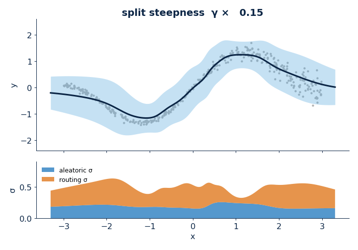
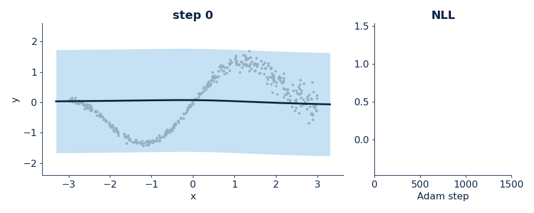
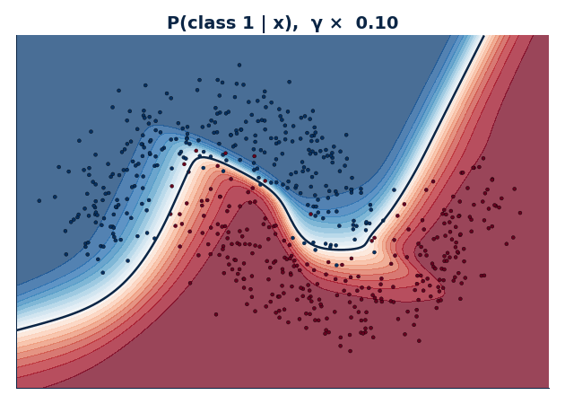
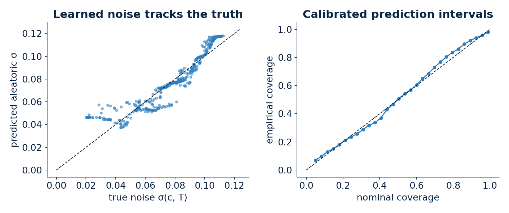
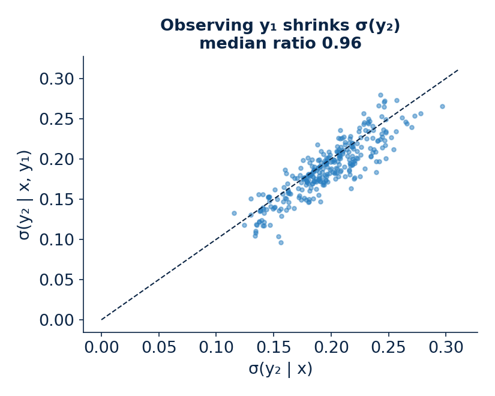
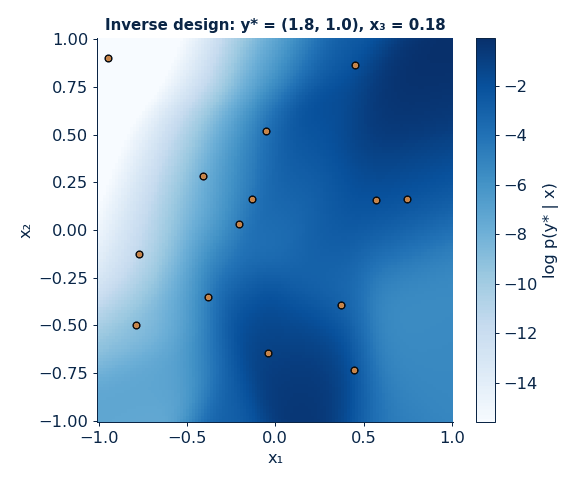

<!-- _class: lead -->
<!-- _paginate: false -->
<!-- _footer: '' -->

# difftree

### Differentiable decision trees in JAX with built-in uncertainty

**John Kitchin**
Carnegie Mellon University · Chemical Engineering

---

## Decision trees: the classic recipe

<div class="cols-3-2">
<div class="side">

- Recursively split data on **one feature** at a time
- Choose each split **greedily** (best impurity drop now)
- Predict with a constant in each leaf
- Fast, interpretable, handles mixed features
- CART (Breiman et al., 1984), ID3 (Quinlan, 1986)

</div>
<div>

<div class="card">
<h4>A hard, axis-aligned split</h4>

`if x[3] < 0.42: go left else: go right`

Every input follows exactly **one** root-to-leaf path.
</div>

</div>
</div>

---

## Three things classic trees cannot do

<div class="cols" style="grid-template-columns: 1fr 1fr 1fr;">
<div class="card">
<h4>Optimize jointly</h4>
Greedy growth fixes early splits; later splits cannot fix them. No gradient flows through <code>if/else</code>.
</div>
<div class="card">
<h4>Split obliquely</h4>
Axis-aligned cuts need staircases to follow a diagonal or curved boundary.
</div>
<div class="card">
<h4>Say how sure they are</h4>
A leaf constant gives a point estimate, not a calibrated predictive distribution.
</div>
</div>

<br>

<div class="callout">
<b>difftree</b> makes every split a smooth function, so the whole tree trains end to end by gradient descent, and keeps that smoothness at test time to report uncertainty.
</div>

---

## Where difftree sits

<div class="flow">
<div style="background:#13315c">Greedy trees<small>CART, ID3</small></div>
<div class="arrow">›</div>
<div style="background:#1f5f99">Oblique trees<small>OC1, non-greedy</small></div>
<div class="arrow">›</div>
<div style="background:#2a7fc1">Soft / neural trees<small>DNDF, soft DT, ANT</small></div>
<div class="arrow">›</div>
<div style="background:#3d93cf">End-to-end trees<small>anneal γ → ∞</small></div>
<div class="arrow">›</div>
<div style="background:#5aa9dd">difftree<small>finite γ + UQ</small></div>
</div>

<br>

<div class="side">

- Hehn et al. (2020) train trees end to end, then **anneal to hard splits**
- difftree keeps splits **finitely soft**: routing ambiguity becomes uncertainty
- Leaves are **Gaussians**, so the output is a calibrated mixture

</div>

---

<!-- _class: lead -->
<!-- _footer: '' -->

# How it works

---

## A soft, oblique split

<div class="cols">
<div class="eq">

$$
s_i(x) = \sigma\big(\gamma_d\,(w_i^\top x + b_i)\big)
$$

- $w_i$: an **oblique** direction (all features at once)
- $\gamma_d$: per-depth **steepness**
- $s_i$ = probability of going right
- $\gamma \to \infty$ recovers a hard split

</div>
<div>

$$
\mu_\ell(x) = \prod_{i \in \text{path}(\ell)} s_i^{\,r_i}\,(1-s_i)^{1-r_i}
$$

<div class="callout">
Path probabilities over all 2<sup>D</sup> leaves sum to one. Computed in log space for stability.
</div>

</div>
</div>

---

## Soft routing: one input, every leaf



<div class="tiny center">Edge width ∝ probability of reaching that node. Labels are the split probabilities.</div>

---

## Leaves are Gaussians, so predictions are mixtures

<div class="eq">

$$
p(y \mid x) = \sum_{\ell=1}^{2^D} \mu_\ell(x)\;\mathcal{N}\!\big(y;\ m_\ell,\ \alpha\,L_\ell L_\ell^\top\big)
$$

$$
\mathrm{Cov}[y\mid x] = \underbrace{\mathbb{E}_\ell\big[\Sigma_\ell\big]}_{\text{aleatoric (within leaf)}} + \underbrace{\mathrm{Cov}_\ell\big[m_\ell\big]}_{\text{routing (between leaves)}}
$$

</div>

- Each leaf has its own mean and **Cholesky** covariance (PD by construction)
- Multi-output $y$ gets a full covariance, not just per-output error bars
- Classification: leaves hold logits; entropy splits the same way

---

## Steepness γ controls smoothness and routing uncertainty

<div class="cols-3-2">
<div>



</div>
<div class="side">

- Small γ: smooth mean, large **routing** σ (orange)
- Large γ: piecewise constant, routing σ only at the boundaries
- Calibration picks a **finite** γ per depth
- Aleatoric σ (blue) is the learned noise level

</div>
</div>

---

## Training: maximize likelihood, then calibrate

<div class="flow">
<div style="background:#13315c">Warmup<small>splits + means, σ frozen</small></div>
<div class="arrow">›</div>
<div style="background:#1f5f99">Full NLL<small>Adam, grad clipping</small></div>
<div class="arrow">›</div>
<div style="background:#2a7fc1">Anneal γ<small>1 → γ<sub>max</sub></small></div>
<div class="arrow">›</div>
<div style="background:#5aa9dd">Calibrate<small>fit log γ<sub>d</sub>, log α on held-out data</small></div>
</div>

<div class="cols-3-2" style="margin-top: 14px;">
<div>



</div>
<div class="side">

- Loss: $-\log p(y \mid x)$, end to end
- Warmup avoids variance collapse
- Calibration is tree-style **temperature scaling**

</div>
</div>

---

## Oblique splits bend to the data

<div class="cols-3-2">
<div>



</div>
<div class="side">

- Depth-4 classifier on two moons
- Each cut is a line in **any direction**
- 15 splits trace a curved boundary
- Soft γ: graded probabilities near the boundary
- Hard γ: a polygon partition

</div>
</div>

---

<!-- _class: lead -->
<!-- _footer: '' -->

# Examples

---

## A scikit-learn estimator

```python
from difftree import DifferentiableTreeRegressor

model = DifferentiableTreeRegressor(depth=5, n_epochs=150, random_state=0)
model.fit(X_train, y_train)

mean, std = model.predict(X_test, return_std=True)
mean, std, std_aleatoric, std_routing = model.predict(X_test, return_components=True)
q05, q50, q95 = model.predict_quantile(X_test, q=[0.05, 0.5, 0.95])
samples = model.sample_y(X_test, n_samples=200)
```

<div class="small">

Also: `DifferentiableTreeClassifier`, `predict_full_cov`, `predict_conditional`, `inverse_design`. Works with pipelines, CV and grid search.

</div>

---

## Example 1: a saturating sensor with heteroscedastic noise



<div class="small">

Michaelis-Menten response in $(c, T)$ with Arrhenius $K_m(T)$; noise $\sigma = 0.02 + 0.1\,f(c,T)$. Depth 5, 1600 training points. The aleatoric σ recovers the noise structure and intervals are calibrated.

</div>

---

## Example 2: knowing one output tightens the other

<div class="cols">
<div>



</div>
<div class="side">

- Two correlated properties $y_1, y_2$ from three inputs
- $p(y_2 \mid x, y_1)$ in **closed form**: Schur complement per leaf, leaf weights reweighted by evidence
- Conditional σ is smaller for most inputs, but modestly here (median ratio 0.96)

```python
m, C, logev = model.predict_conditional(
    X, observed={0: y1})
```

</div>
</div>

---

## Example 3: inverse design by gradient ascent

<div class="cols">
<div>



</div>
<div class="side">

- Target properties $y^* = (1.8,\ 1.0)$
- Maximize $\log p(y^* \mid x)$ over $x$
- Tree is smooth in $x$, so use `jax.grad`
- Multi-start Adam finds **several** solutions
- Partial targets and box bounds supported

</div>
</div>

---

<!-- _class: lead -->
<!-- _footer: '' -->

# Pros, cons and limitations

---

## Strengths

<div class="cols">
<div class="card pro">
<h4>Uncertainty is built in</h4>
Mixture predictive with aleatoric / routing split, quantiles, samples, full covariance.
</div>
<div class="card pro">
<h4>Calibrated</h4>
Post-hoc γ and α fit on held-out data; coverage tracks nominal.
</div>
<div class="card pro">
<h4>Differentiable everywhere</h4>
End-to-end training, gradients in <i>x</i> for inverse design, composable with JAX.
</div>
<div class="card pro">
<h4>Multi-output for free</h4>
Closed-form conditioning on observed outputs; correlated predictions.
</div>
<div class="card pro">
<h4>Oblique splits</h4>
Fewer leaves for diagonal or curved structure than axis-aligned trees.
</div>
<div class="card pro">
<h4>Familiar API</h4>
scikit-learn estimators; small codebase (JAX + optax).
</div>
</div>

---

## Weaknesses and limitations

<div class="cols">
<div class="card con">
<h4>Fixed, full depth</h4>
2<sup>D</sup>−1 splits; practical depth ≲ 10 to 12. No grown or pruned trees yet.
</div>
<div class="card con">
<h4>Every leaf is evaluated</h4>
Soft routing costs O(2<sup>D</sup>) per input, not O(D) like a hard tree.
</div>
<div class="card con">
<h4>Less interpretable</h4>
Oblique, soft splits are harder to read than "x₃ &lt; 0.42".
</div>
<div class="card con">
<h4>Non-convex training</h4>
Seed sensitive: a 1D test gave RMSE 0.16 to 0.35 at depth 4 across 4 seeds.
</div>
<div class="card con">
<h4>Local inverse design</h4>
Multimodal likelihood; relies on multi-start ascent.
</div>
<div class="card con">
<h4>Single tree, aleatoric-heavy UQ</h4>
No ensemble or Bayesian treatment of parameters; linear splits only for now.
</div>
</div>

---

## Take-home

<div class="callout">

**difftree** = soft oblique splits + Gaussian leaves + calibration.
One differentiable model gives a predictive **distribution**, not just a number.

</div>

<br>

- Good fit: tabular, moderate-size problems that need **calibrated UQ**
- Multi-output properties: **conditioning** and **inverse design** fall out
- Watch: depth limits, seeds, and multi-start for design

<br>

<div class="center muted">Questions?</div>

---

## References

<div class="ref">

L. Breiman, J. Friedman, R. Olshen, C. Stone, *Classification and Regression Trees*, Chapman & Hall/CRC (1984).

J. R. Quinlan, Induction of decision trees, *Machine Learning* 1, 81 (1986). doi:10.1007/BF00116251

P. Kontschieder et al., Deep Neural Decision Forests, *ICCV* (2015). doi:10.1109/ICCV.2015.172

N. Frosst, G. Hinton, Distilling a Neural Network Into a Soft Decision Tree, arXiv:1711.09784 (2017).

C. Guo et al., On Calibration of Modern Neural Networks, *ICML* (2017). arXiv:1706.04599

T. M. Hehn, J. F. P. Kooij, F. A. Hamprecht, End-to-End Learning of Decision Trees and Forests, *IJCV* 128, 997 (2020). doi:10.1007/s11263-019-01237-6

</div>

<div class="tiny">Figures: <code>presentation/make_figures.py</code>, <code>presentation/make_tree_svg.py</code></div>
